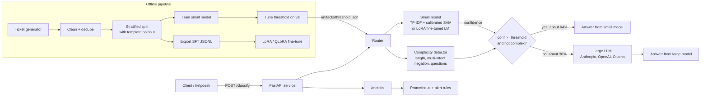
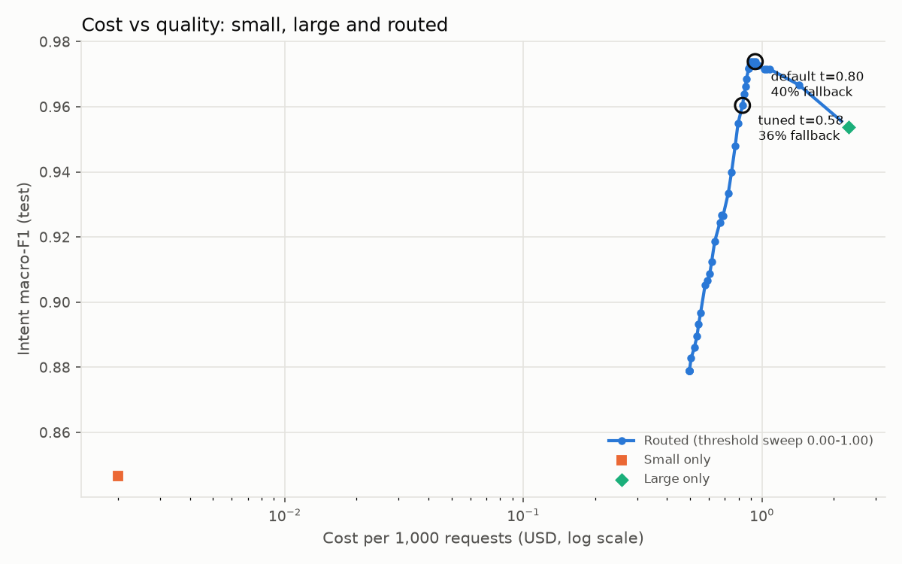

# ModelRoute

**Smaller models. Bigger impact.** Send support tickets to a small classifier first, and pass only the hard or uncertain ones to a large LLM. The goal is lower cost and latency without losing quality.

[](pyproject.toml)
[](LICENSE)
[](https://github.com/Navyagowda2714/modelroute/actions/workflows/ci.yml)
[](https://github.com/astral-sh/ruff)

## Why this exists

Many teams send every ticket-triage, intent-detection or routing call to a frontier LLM. Most of those requests are easy. A model that is 100x cheaper and runs in milliseconds would answer them correctly. The hard part is knowing *which* requests are easy. ModelRoute shows the full workflow on a realistic task (support-ticket intent, category and priority):

1. Build a dataset.
2. Fine-tune a lightweight model.
3. Measure that model's calibrated confidence.
4. Route on that confidence plus a complexity check.
5. Prove the trade-off with a cost/quality curve.
6. Serve the result with metrics a team can alert on.

## Key features

- **Dataset generator.** Produces 6,000 labelled tickets across 20 intents, 5 categories and 4 priorities. It adds paraphrases, typos, filler context, multi-intent and negation tickets, and deliberate 1-3% label noise. The split is stratified with a **template-group holdout**, so val/test contain phrasings the model never saw. See [docs/DATA_CARD.md](docs/DATA_CARD.md).
- **Fine-tuning script.** A real LoRA / QLoRA script (`transformers` + `peft` + `bitsandbytes`) with YAML configs for Qwen2.5-0.5B and Llama-3.1-8B. It masks the prompt from the loss and runs a generation-based eval callback. A matching `HFLoraClassifier` scores candidate likelihoods to get the confidence.
- **Runnable small model.** TF-IDF (word + char n-grams) feeds a calibrated linear SVM. It sits behind the same `Classifier` interface, trains in about 5 s on a CPU, and has an ECE of 0.041.
- **Router.** The small model always runs first. A request falls back to the large LLM when calibrated confidence is below the threshold, or when the explainable complexity detector flags it (length, multi-intent markers, negated requests, multiple questions). If the large model fails, the router degrades gracefully to the small model's answer.
- **Threshold tuning on validation.** The tuner picks the cheapest threshold whose macro-F1 is within 1 pt of large-only. It also produces a cost-vs-quality Pareto chart and a sensitivity analysis over the large model's assumed accuracy.
- **Serving.** A FastAPI service exposes `/classify` and Prometheus `/metrics`: requests by route, fallbacks by reason, a latency histogram, a cost counter and a rolling fallback ratio. Fallbacks are logged as structured JSON with no raw text. Docker Compose bundles Prometheus with alert rules.
- **Provider-agnostic LLM layer.** Supports Anthropic, OpenAI, Ollama and a deterministic offline stand-in.

## What was run here (read this first)

| Component | Status in this repo |
|---|---|
| TF-IDF + calibrated SVM small model | **Trained and evaluated here.** All small-model numbers are measured. |
| LoRA/QLoRA fine-tune (`finetune/train_lora.py`) | **Not run here.** No GPU or Hugging Face access in the build environment. The code, configs, SFT export and masking logic are unit-tested. |
| Large LLM in `make eval` | **Simulated** (`SimulatedLLMClassifier`). Its accuracy (90-97% by ticket type) and latency (lognormal, median 850 ms) are **assumptions**. Its token counts come from the real prompt. |
| Large LLM in the API / demo | `LLM_PROVIDER=anthropic\|openai\|ollama` for a real model. Otherwise a transparent **keyword heuristic** (`OfflineProvider`) stands in so the service runs with no key. |
| Prices | Illustrative values in [`configs/prices.yaml`](configs/prices.yaml). Edit them to match your contract. |

The routing mechanics, calibration and small-model quality are real. The large-model quality is an input to the analysis, not a result. The [sensitivity table](docs/EVALUATION.md#sensitivity-to-the-large-model-assumption) shows how the conclusions move when that input changes.

## Architecture



The small model runs on every request; it costs about 1/1000th of an LLM call and its calibrated probability is the routing signal. The complexity detector catches the cases where a bag-of-words model is *confidently wrong*: negations and multi-intent tickets. A request falls back if either signal fires. The tuned threshold comes from the offline pipeline, which runs the same detector and cost model as the online router, so offline and online behaviour match. For sequence diagrams, ADRs and failure modes, see [docs/ARCHITECTURE.md](docs/ARCHITECTURE.md).

## Quickstart

```bash
git clone https://github.com/Navyagowda2714/modelroute && cd modelroute
python -m venv .venv && source .venv/bin/activate
make install          # pip install -e ".[dev]"

make demo             # generates data, trains the small model (~5 s), routes six example tickets
make eval             # full benchmark -> docs/results/eval_results.json + docs/images/*.png
make test             # 36 tests, no network
make serve            # FastAPI on :8000
```

**Use a real large model for fallbacks:**

```bash
pip install -e ".[anthropic]"
export LLM_PROVIDER=anthropic ANTHROPIC_API_KEY=...   # default model claude-sonnet-5-5
# or: LLM_PROVIDER=openai OPENAI_API_KEY=...  |  LLM_PROVIDER=ollama LLM_MODEL=llama3.1
make serve
```

If a hosted provider is selected but its key is missing, the service logs a warning and falls back to offline mode instead of crashing.

**Fine-tune the small LM (on a GPU machine):**

```bash
pip install -e ".[finetune]"
make export-sft                                           # data/generated/sft_{train,val}.jsonl
python -m modelroute.finetune.train_lora configs/lora_qwen2.5-0.5b.yaml
```

**Docker (service + Prometheus):**

```bash
docker compose up --build      # API on :8000, Prometheus on :9090 (alert rules in deploy/alerts.yml)
```

## Usage

### CLI demo (real output from `make demo`)

```text
router: small=small-tfidf-svm large=llm-offline-heuristic threshold=0.58

> Hi, I was charged twice for my Pro subscription this month, $49.00 two times.
  route=small intent=billing_double_charge priority=high small_conf=0.97 reasons=- cost=$0.000002

> I'm not trying to cancel my subscription, the Team plan is just too expensive for us now, is there something smaller we can keep?
  route=large intent=downgrade_plan priority=low small_conf=0.97 reasons=complex:negation cost=$0.001730

> The headphones arrived with a cracked case. Also, can you send an invoice for the order?
  route=large intent=damaged_item priority=medium small_conf=0.54 reasons=complex:multi_intent,low_confidence cost=$0.001715
```

The second ticket shows why the complexity gate exists. The small model is 97% confident, but the sentence opens with a negated "cancel", which is exactly where bag-of-words models fail. Threshold 0.58 is the value `make eval` tuned on the validation split.

### API

```bash
curl -s -X POST localhost:8000/classify -H 'content-type: application/json' \
  -d '{"text":"I was charged twice for my Team subscription, please fix this ASAP"}'
```

```json
{"request_id":"25ce5d5914f3434a","intent":"billing_double_charge","category":"billing","priority":"urgent",
 "confidence":0.9335,"route":"small","reasons":[],"model":"small-tfidf-svm","latency_ms":16.923,
 "cost_usd":2e-6,"degraded":false}
```

Here is an excerpt from `/metrics` after five requests, followed by a fallback log line (both copied from a local run):

```text
modelroute_requests_total{route="small"} 3.0
modelroute_requests_total{route="large"} 2.0
modelroute_fallbacks_total{reason="complex:multi_intent"} 2.0
modelroute_cost_usd_total{model="llm-offline-heuristic"} 0.003384
modelroute_fallback_ratio 0.4
```

```json
{"ts": "2026-10-24T19:33:02.970Z", "level": "INFO", "logger": "modelroute.fallback", "event": "route.fallback",
 "request_id": "2753a17a9f2e47ad", "reasons": ["complex:multi_intent"], "route": "large",
 "small_intent": "damaged_item", "small_confidence": 0.903, "final_intent": "damaged_item",
 "complexity_score": 1.0, "text_sha256": "9131adabead7721d", "text_chars": 60, "degraded": false}
```

### Python

```python
from modelroute.models import SmallClassifier, LLMClassifier
from modelroute.llm import get_llm_client
from modelroute.routing import Router, RouterConfig
from modelroute.evaluation import load_prices

router = Router(SmallClassifier.load("artifacts/small_model.joblib"),
                LLMClassifier(get_llm_client()),            # honours LLM_PROVIDER
                load_prices(), RouterConfig(threshold=0.58))
decision = router.route("my parcel is stuck in transit for a week")
print(decision.route, decision.prediction.intent, decision.reasons, decision.cost_usd)
```

## Evaluation

These are the `make eval` results on the 859-ticket test split. 27% of its tickets use phrasings never seen in training. The small model numbers are measured. **Large-model quality and latency are simulated assumptions** (see above). Costs come from the illustrative price table.

| Strategy | Intent acc | Intent macro-F1 | Priority acc | p50 ms | p95 ms | $/1k req | Fallback |
|---|---:|---:|---:|---:|---:|---:|---:|
| small-only | 0.846 | 0.846 | 0.820 | 11.2 | 26.0 | 0.0020 | 0.0% |
| large-only (simulated) | 0.955 | 0.954 | 0.868 | 858.4 | 1524.1 | 2.3055 | 100.0% |
| routed (default t=0.80) | 0.974 | 0.974 | 0.907 | 21.6 | 1251.8 | 0.9373 | 40.3% |
| **routed (tuned t=0.58)** | **0.960** | **0.960** | **0.893** | **18.3** | **1223.8** | **0.8289** | **35.6%** |
| routed, confidence only (t=0.58) | 0.950 | 0.950 | 0.880 | 13.6 | 1030.0 | 0.4505 | 19.4% |

Compared with large-only, the tuned router **cuts cost by 64% and p50 latency by 98%, with macro-F1 0.7 pt higher**. The routed system can beat large-only because the small model is 97% accurate on familiar phrasings, which is better than the assumed LLM error rate there. The sensitivity analysis shows this gain shrinks to roughly zero if the LLM is assumed to be 98% accurate. p95 latency barely improves, because the slowest 5% of requests are fallbacks either way.



For methodology, the per-slice breakdown (seen vs unseen phrasing, ticket type), the calibration plot and the sensitivity analysis, see [docs/EVALUATION.md](docs/EVALUATION.md).

## Design decisions and trade-offs

- **Confidence *and* complexity, not confidence alone.** A calibrated model is still confidently wrong on negations. The detector adds about 16 pts of fallback for +1 pt macro-F1 (the last two rows of the table). That is a business decision, so it is a flag: `MODELROUTE_USE_COMPLEXITY`.
- **Small model always runs.** The router does not try to predict whether to skip it. At about 10 ms and $0.000002 per call, the cheapest model doubles as the router's feature extractor.
- **Threshold tuned on val, reported on test.** The rule is explicit (cheapest point within 1 pt of large-only) and stored in `artifacts/threshold.json`, which the service loads at startup.
- **Category derived from intent.** One head fewer, and the labels can never contradict each other.
- **Explainable complexity rules over a learned complexity model.** They are fast, auditable and logged as fallback reasons. The trade-off is lower recall: many long tickets are not flagged by the length rule and are covered only by the confidence gate.
- **Simulated LLM in eval, not a heuristic.** A keyword heuristic would make "large" look worse than the small model and invert the story. Stating the LLM's accuracy as an explicit, swept assumption is more honest.

## Project structure

```text
modelroute/
├── configs/                 # prices.yaml, lora_qwen2.5-0.5b.yaml, lora_llama3.1-8b.yaml
├── data/sample_tickets.jsonl
├── deploy/                  # prometheus.yml, alerts.yml
├── docs/                    # ARCHITECTURE.md, EVALUATION.md, DATA_CARD.md, images/, results/
├── examples/                # route_tickets.py, api_client.py
├── src/modelroute/
│   ├── data/                # taxonomy, templates, generator, cleaning + split
│   ├── models/              # Classifier protocol, SmallClassifier, LLMClassifier, simulator
│   ├── finetune/            # SFT formatting, LoRA/QLoRA trainer, HF LoRA classifier
│   ├── routing/             # complexity detector, router, threshold tuning
│   ├── evaluation/          # metrics, pricing, benchmark, plots
│   ├── serving/             # FastAPI app, Prometheus metrics
│   ├── llm/                 # LLMClient protocol + Anthropic/OpenAI/Ollama/offline providers
│   └── cli.py
├── tests/                   # 36 tests
├── Dockerfile, docker-compose.yml, Makefile, pyproject.toml
```

## Roadmap

- Run the QLoRA fine-tune on a GPU and add its row to the eval table, with temperature scaling fitted on val.
- Replace the simulator with a recorded real-LLM run on the test split, cached so CI can replay it.
- Add a shadow mode that sends a small sample of small-routed traffic to the LLM as well, to estimate online accuracy and detect drift.
- Use per-intent thresholds, since some intents are calibrated better than others.
- Add a Grafana dashboard JSON next to the Prometheus config.

## License

MIT, see [LICENSE](LICENSE).

Built by [Navyashree Byregowda](https://www.linkedin.com/in/navyashree-byregowda-472821196/)
