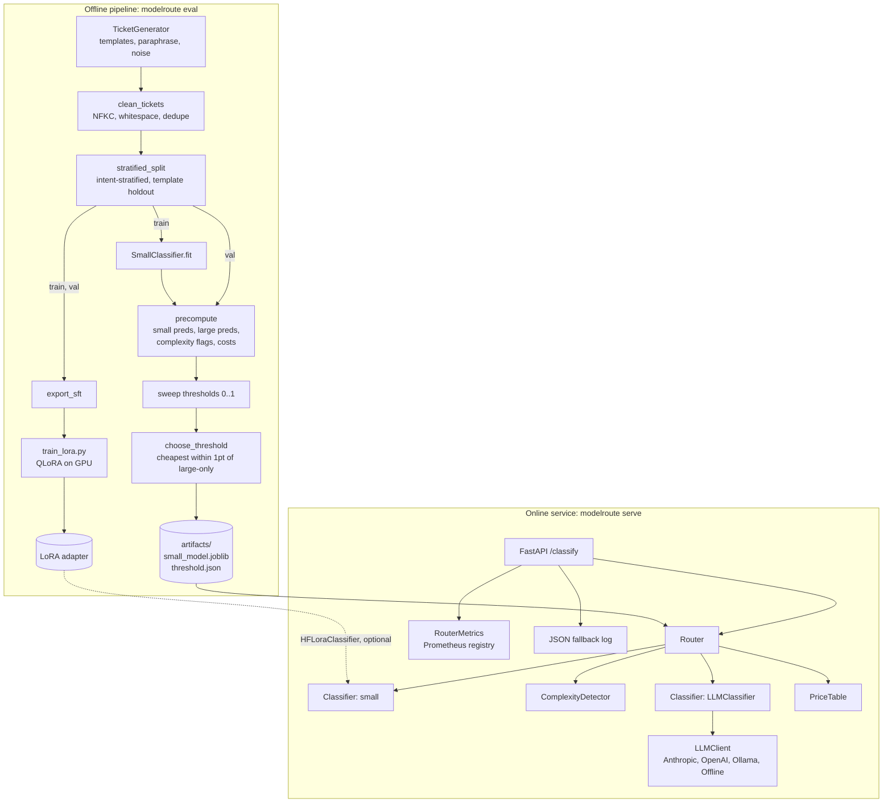
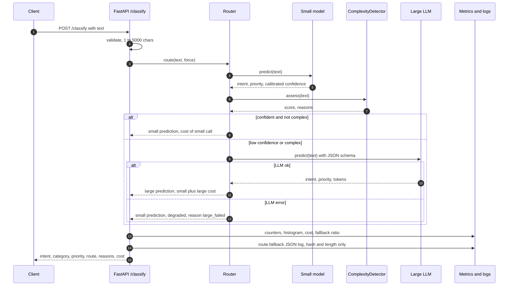
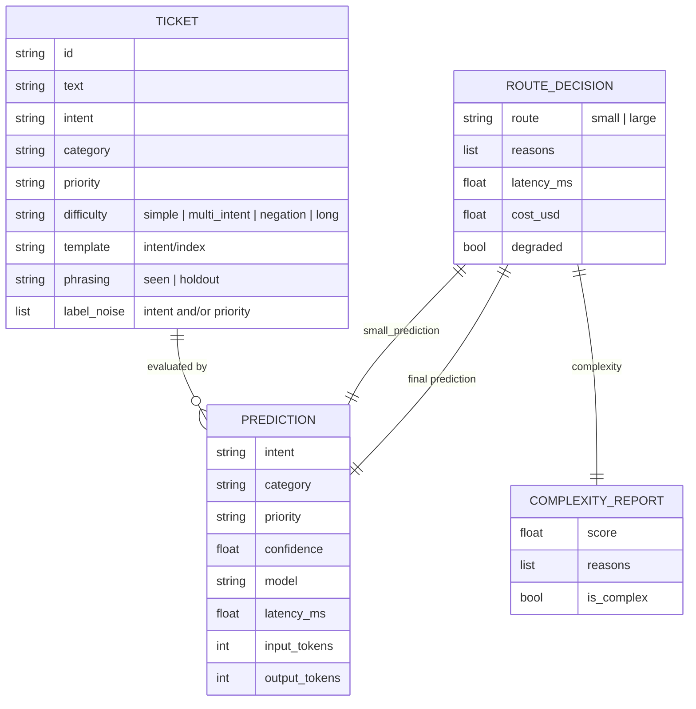
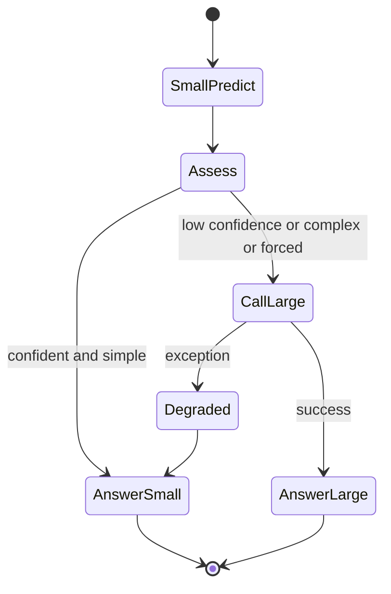

# ModelRoute architecture

## Overview

ModelRoute answers one question for every incoming support ticket: *can the cheap model be trusted with this one?* The system has two halves:

- **Offline pipeline.** It generates and splits data, trains the small model (and optionally LoRA-fine-tunes a small LM), simulates every routing policy on the validation split, and writes the tuned threshold.
- **Online service.** It runs the small model on every request, applies the confidence and complexity gate, calls the large LLM only when needed, and exports metrics and structured fallback logs.

Both halves share the same `Classifier` protocol, `ComplexityDetector` and `PriceTable`. The routing policy is therefore defined once, and a threshold tuned offline means the same thing online.

## Components

| Component | Module | Responsibility |
|---|---|---|
| Taxonomy | `data/taxonomy.py` | 20 intents -> 5 categories, base priority, descriptions (also used in the LLM prompt) |
| Generator | `data/generator.py`, `data/templates.py` | Deterministic synthetic tickets with difficulty types and controlled label noise |
| Preprocessing | `data/preprocess.py` | Cleaning, de-duplication, stratified split with template-group holdout, JSONL I/O, stats |
| Small model | `models/small.py` | Word + char TF-IDF -> `CalibratedClassifierCV(LinearSVC)` for intent, logistic regression for priority |
| LoRA model | `finetune/` | SFT formatting, QLoRA trainer with generation eval callback, `HFLoraClassifier` (likelihood-scored confidence) |
| Large model | `models/large.py` | `LLMClassifier` (prompt + JSON schema + retry on bad JSON), keyword offline handler, `SimulatedLLMClassifier` for eval |
| LLM layer | `llm/` | `LLMClient` protocol, Anthropic, OpenAI and Ollama providers with lazy SDK imports, deterministic offline providers |
| Complexity detector | `routing/complexity.py` | Weighted rule signals -> `ComplexityReport(score, reasons, is_complex)` |
| Router | `routing/router.py` | Policy, cost accounting, graceful degradation |
| Tuning | `routing/tuning.py` | Vectorised policy simulation over precomputed predictions, threshold selection |
| Evaluation | `evaluation/` | Metrics (acc, macro-F1, ECE, percentiles), price table, benchmark orchestration, charts |
| Serving | `serving/` | FastAPI app factory, per-app Prometheus registry |

## Request lifecycle

## Data model

The router's decision for one request moves through these states:

## Design decisions

**ADR-1: The small model always runs first.**
*Context:* A router needs a signal, and a separate "difficulty predictor" is a second model to build and maintain.
*Decision:* Run the small classifier on every request and use its calibrated max-probability as the main signal.
*Consequences:* Every request pays about 10 ms and $0.000002. In return, routing needs no extra model, and the small answer is available as a fallback when the LLM is down.

**ADR-2: Calibrated linear SVM as the runnable baseline.**
*Context:* Raw SVM margins are not probabilities, and a threshold of 0.8 must mean "80% likely right".
*Decision:* Use `CalibratedClassifierCV(LinearSVC, method="sigmoid", cv=5)`. Report ECE and a reliability plot.
*Consequences:* Test ECE is 0.041. Training is 5x slower than a single SVM (5 folds), which is still about 5 s.

**ADR-3: Add a rule-based complexity gate.**
*Context:* Calibration is measured on the average ticket. Negations ("I'm not trying to cancel...") produce confident errors because the decoy word carries the most weight.
*Decision:* Add four explainable rules, combined by weighted score. Their reasons are logged and exported as Prometheus labels.
*Consequences:* Fallback rises from 19% to 36% and macro-F1 rises by 1 pt. Operators can turn the gate off with `MODELROUTE_USE_COMPLEXITY=false`.

**ADR-4: Template-group holdout in the split.**
*Context:* A random split of template-generated data leaks phrasings, and the first version of this project scored 99% accuracy, which measures nothing.
*Decision:* Hold out 2 templates per intent from training and place those tickets only in val/test.
*Consequences:* The test set has a seen subset (97% small-model accuracy) and an unseen-phrasing subset (51%). That is the gap the router must cover, and it resembles production drift.

**ADR-5: Simulate the large model in eval.**
*Context:* No LLM API is reachable in CI, and a keyword stand-in would make the "large" model worse than the small one.
*Decision:* Use an oracle-with-noise simulator with explicit, per-difficulty accuracy assumptions and a lognormal latency, plus a sensitivity sweep over accuracy.
*Consequences:* Cost, latency mechanics and fallback rates are meaningful. Absolute large-model quality is an input, and the docs say so.

**ADR-6: Category is derived from intent.**
*Context:* Three independent heads can disagree (intent `refund_request`, category `shipping`).
*Decision:* Predict intent and priority, and look category up in the taxonomy.
*Consequences:* Labels are always consistent. Category accuracy is at least intent accuracy.

## Failure modes and mitigations

| Failure | Effect | Mitigation |
|---|---|---|
| LLM provider down or timing out | Fallback requests fail | Router catches the error and serves the small answer (`degraded=true`, reason `large_failed`), with a `LargeModelDegraded` alert |
| LLM returns invalid JSON or an unknown intent | Unparseable answer | JSON extraction tolerates fences and prose. Retries once, then raises, and the router degrades |
| Missing API key | Startup crash | Factory falls back to offline mode with a warning log |
| Traffic drift (new phrasings) | Small-model confidence drops, fallback rises, cost rises | `modelroute_fallback_ratio` gauge and `FallbackRateHigh` alert. Retrain on fallback-labelled traffic |
| Confidently wrong small model | Silent quality loss | Complexity gate. Roadmap: shadow-sample small-routed traffic to the LLM |
| Small model artifact missing | `/classify` unusable | `/health` returns 503 with a clear message. The Docker image trains at build time |
| PII in logs | Compliance risk | Fallback logs contain a SHA-256 prefix and length only, never the ticket text |

## Security considerations

- No secrets in the repo. Keys come from the environment (`.env.example` lists them), and `.env` is git-ignored.
- Input is bounded to 5,000 characters by pydantic validation. Larger payloads get a 422.
- Prompt injection: the ticket is wrapped in delimiters and the output is constrained to a JSON enum of intents. An injected instruction can at worst change the label, not trigger actions.
- The container runs as a non-root user (uid 10001).
- The fine-tuning path loads model weights from Hugging Face. Pin revisions in production and prefer `safetensors`.

## Scaling and cost

- **Small model:** CPU-bound at about 10 ms per request single-threaded and stateless, so it scales horizontally. Batching (`predict_batch`) amortises vectorisation for queue consumers.
- **Large model:** The cost driver is prompt tokens, about 600 per call because the taxonomy is in the system prompt. Prompt caching on the provider side, or the fine-tuned LoRA model as the "large" tier, cut this further.
- **Cost model:** Cost per 1k requests = small cost x 1000 + fallback rate x large cost x 1000. At the tuned threshold that is $0.83 vs $2.31 per 1k (illustrative prices). The fallback rate is the lever, which is why it is a first-class metric.
- **Threshold as a dial:** The Pareto curve in `docs/images/pareto.png` is the menu of operating points. Ops can move along it with `MODELROUTE_THRESHOLD` without redeploying code.

## Extending the system

- **New small model:** Implement `name`, `predict` and `predict_batch` returning `Prediction`, then pass it to `Router`. `HFLoraClassifier` is an example.
- **New provider:** Implement `LLMClient.complete` and add a branch in `llm/factory.py`.
- **New routing signal:** Add a rule to `ComplexityDetector`, or subclass `Router.fallback_reasons`. The new reason string appears in metrics and logs automatically.
- **New task:** Swap the taxonomy and templates. The router, tuning, evaluation and serving code is task-agnostic apart from the `Prediction` fields.
