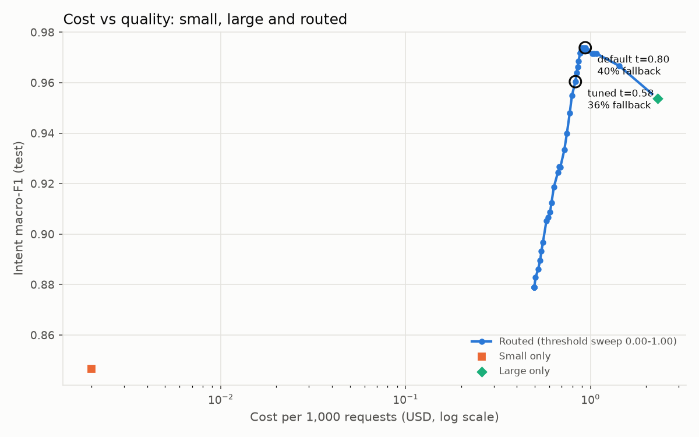
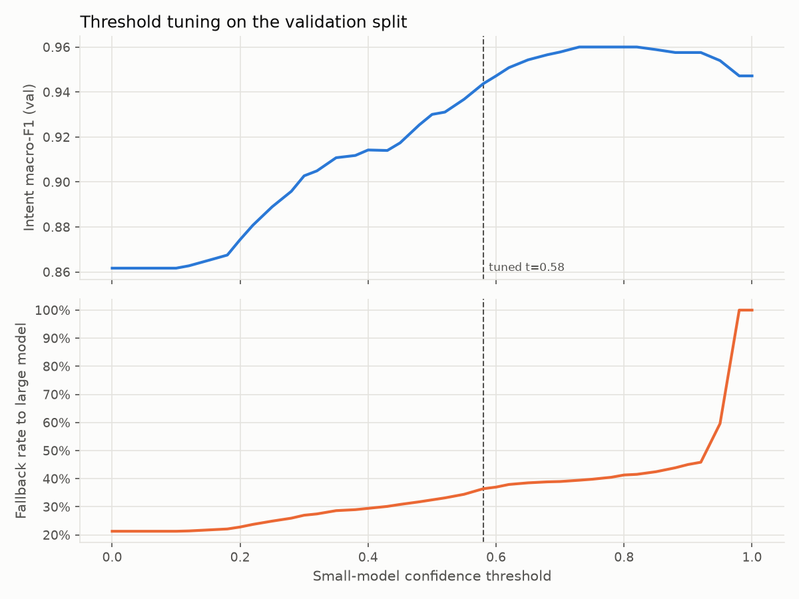
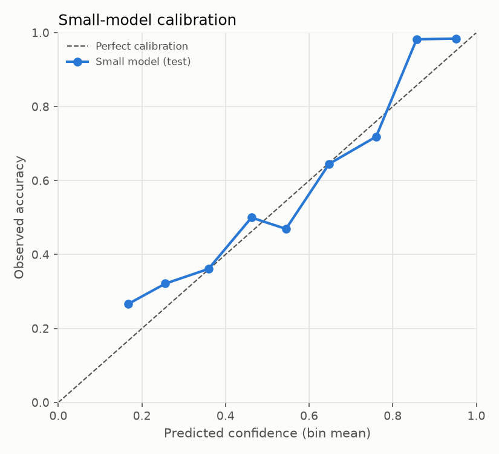

# Evaluation

All numbers below were produced by `make eval` (`modelroute eval`) in this repository's build environment. The raw output is in [`results/eval_results.json`](results/eval_results.json).

## What is measured and what is assumed

| Quantity | Source |
|---|---|
| Small model accuracy, F1, priority accuracy, calibration | **Measured.** Trained on train, evaluated on test |
| Small model latency | **Measured.** Single-request `predict()` calls on one CPU core, after 20 warm-up calls |
| Large model accuracy | **Assumed.** `SimulatedLLMClassifier`: 97% (simple), 96% (long), 94% (negation), 90% (multi-intent) intent accuracy; 90% priority accuracy. Rows with deliberately corrupted gold labels are always "wrong" for it |
| Large model latency | **Assumed.** Lognormal, median 850 ms, sigma 0.35 |
| Large model tokens | **Computed** from the real prompt (system prompt with taxonomy + JSON schema + ticket), about 4 chars per token; 24 output tokens |
| Prices | `configs/prices.yaml`. Illustrative: large $3 / $15 per 1M in/out tokens; small $0.000002 per request |

## Methodology

1. **Data.** 6,000 generated tickets, 273 exact duplicates removed, leaving 5,727. Split: train 4,009 / val 859 / test 859, stratified by intent. Two templates per intent are **held out of training**, so 248 val and 236 test tickets use phrasings the model never saw (see [DATA_CARD.md](DATA_CARD.md)).
2. **Train.** TF-IDF (word 1-2 grams + char_wb 3-5 grams) feeds `CalibratedClassifierCV(LinearSVC, sigmoid, cv=5)` for intent and a balanced logistic regression for priority.
3. **Precompute.** For val and test: small-model predictions, simulated large predictions, the complexity flag and per-request cost. Every routing policy is then a mask over these arrays, using the same detector and cost model as the online `Router`.
4. **Tune on val.** Sweep the threshold over 0.00-1.00 in steps of 0.025. Choose the **cheapest threshold whose val macro-F1 is within 1 pt of large-only** (val large-only macro-F1 is 0.947). The chosen threshold is **0.58**.
5. **Report on test** for small-only, large-only, routed at the default 0.80, routed at the tuned 0.58, and a confidence-only ablation.

## Results (test split, n = 859)

| Strategy | Intent acc | Intent macro-F1 | Priority acc | p50 ms | p95 ms | $/1k req | Fallback |
|---|---:|---:|---:|---:|---:|---:|---:|
| small-only | 0.846 | 0.846 | 0.820 | 11.2 | 26.0 | 0.0020 | 0.0% |
| large-only (simulated) | 0.955 | 0.954 | 0.868 | 858.4 | 1524.1 | 2.3055 | 100.0% |
| routed (default t=0.80) | 0.974 | 0.974 | 0.907 | 21.6 | 1251.8 | 0.9373 | 40.3% |
| **routed (tuned t=0.58)** | **0.960** | **0.960** | **0.893** | **18.3** | **1223.8** | **0.8289** | **35.6%** |
| routed, confidence only (t=0.58) | 0.950 | 0.950 | 0.880 | 13.6 | 1030.0 | 0.4505 | 19.4% |

**Tuned router vs large-only: cost -64.0%, p50 latency -97.9%, macro-F1 +0.007.**

How to read this:

- The small model alone is cheap but 11 pts worse than the simulated LLM.
- Routing recovers all of that gap and slightly exceeds large-only. On familiar phrasings the small model (97.4%) is more accurate than the LLM is assumed to be (about 96-97%), so keeping those requests local *helps* quality. This depends on the assumption; see the sensitivity analysis below.
- The default threshold 0.80 gives the best quality (0.974) at 13% higher cost than the tuned point. The tuning rule optimises cost under a quality floor, not quality.
- The complexity gate is worth +1.0 pt macro-F1 for +16 pts of fallback (+$0.38 per 1k). That is a policy choice, exposed as a flag.
- p95 latency stays above 1 s for any policy that falls back more than 5% of the time. The router improves typical latency, not tail latency.

### Threshold sweep on validation

| Threshold | Val macro-F1 | Fallback | $/1k |
|---:|---:|---:|---:|
| 0.00 (complexity gate only) | 0.862 | 21.3% | 0.499 |
| 0.30 | 0.903 | 27.0% | 0.630 |
| 0.50 | 0.930 | 32.5% | 0.756 |
| **0.58** | **0.944** | **36.4%** | **0.846** |
| 0.70 | 0.958 | 39.0% | 0.905 |
| 0.80 | 0.960 | 41.3% | 0.959 |
| 0.90 | 0.958 | 45.1% | 1.047 |
| 1.00 (everything falls back) | 0.947 | 100% | 2.305 |

Quality peaks around 0.75-0.85 and then *declines* toward large-only, because past that point confident and correct small-model answers are replaced by LLM answers that carry a 3-4% assumed error.

### Calibration

Test ECE (10 equal-width bins) is **0.041**. The reliability curve tracks the diagonal. The model is slightly over-confident in the 0.5-0.8 range and under-confident above 0.85, which is the region that matters for a 0.58 threshold.

### Breakdown by slice (test, tuned t=0.58)

| Slice | n | Small acc | Routed acc | Fallback |
|---|---:|---:|---:|---:|
| phrasing = seen | 623 | 0.974 | 0.981 | 21.4% |
| phrasing = holdout (unseen wording) | 236 | 0.509 | 0.907 | 73.3% |
| difficulty = simple | 651 | 0.865 | 0.965 | 20.4% |
| difficulty = long | 58 | 0.862 | 0.966 | 39.7% |
| difficulty = negation | 62 | 0.806 | 0.968 | 100% |
| difficulty = multi_intent | 88 | 0.727 | 0.920 | 100% |

The router works where it should. It sends 73% of unseen-phrasing tickets to the LLM (where the small model is at 51%), but only 21% of familiar ones.

## Sensitivity to the large-model assumption

The same tuned threshold (0.58) was re-run with a uniform assumed LLM intent accuracy:

| Assumed LLM accuracy | Large-only macro-F1 | Routed macro-F1 | Routed $/1k | Large $/1k |
|---:|---:|---:|---:|---:|
| 0.90 | 0.886 | 0.947 | 0.829 | 2.306 |
| 0.95 | 0.952 | 0.966 | 0.829 | 2.306 |
| 0.98 | 0.972 | 0.972 | 0.829 | 2.306 |

**The cost saving (64%) is independent of the LLM's quality**, because it depends only on the fallback rate. The quality conclusion holds for LLM accuracy up to about 98%. Above that, the router matches the LLM but no longer beats it, and a stricter threshold would be needed to stay within 1 pt.

## Limitations

- Synthetic data. Real tickets have longer tails, mixed languages, attachments and much messier label noise. Absolute accuracy here should not be compared with production systems.
- The LLM is simulated. A real run (set `LLM_PROVIDER`, then replace `SimulatedLLMClassifier` with `LLMClassifier` in `benchmark.py`) is the first item on the roadmap.
- The LoRA fine-tune was not run here, so there is no "fine-tuned LM" row yet.
- Latency is single-process on a shared CPU. Absolute milliseconds vary across runs and machines (p50 small-model latency was 9-11 ms across runs), but the ratios are stable.
